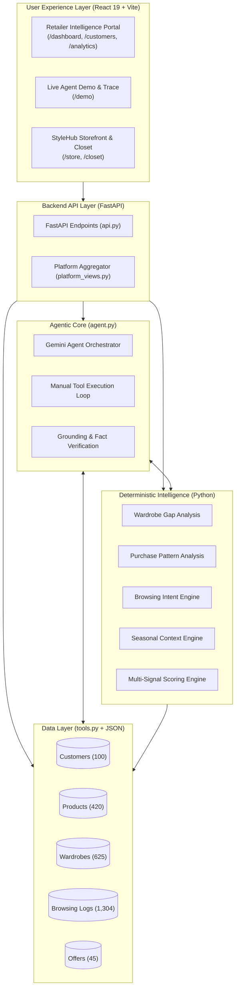

<p align="center">
  
</p>

<h1 align="center">Recon — AI Retail Intelligence & Grounded Style Agent</h1>

<p align="center">
  <strong>Autonomous AI agent for personalized customer recommendations, wardrobe gap analysis, and explainable multi-signal merchandising.</strong>
</p>

<p align="center">
  <a href="https://github.com/Ranjith9916/recon-retail-agent"></a>
  
  
  
  
  
  
  
</p>

---

## 🌟 Overview

**Recon** is an enterprise-grade retail intelligence platform and customer recommendation system built for the **Personalized Retail Recommendation Agent** challenge. 

Rather than relying purely on black-box generative models that are prone to hallucinated inventory and invalid discounts, Recon combines **deterministic Python intelligence pipelines**, a **transparent multi-signal scoring engine**, and an **agentic Gemini LLM orchestrator** with strict grounding verification.

Every recommendation produced by Recon is **100% data-backed**, inspectable down to every single point awarded, and verified against actual catalogue stock and active promotional offers.

---

## 🚀 Key Features

* 🧠 **Deterministic Customer Intelligence**: Derives genuine wardrobe gaps, purchase habits, real-time browsing intent, and seasonal resonance without relying on LLM guesses.
* ⚖️ **Explainable Multi-Signal Scoring Engine**: A transparent ranking matrix where every candidate item receives points backed by explicit evidence (e.g. `+30` for missing wardrobe category, `+18` for high browsing velocity, `+10` for active qualified promotion).
* 🤖 **Autonomous Gemini Agent with Manual Tool Calling**: Employs Google Gemini with manual function-calling orchestration. The agent autonomously requests data, explores tailored catalogue subsets, selects top picks, and crafts personalised merchandising briefs.
* 🛡️ **Zero-Hallucination Grounding Engine**: Fact-checks model outputs against catalogue items, pricing, and active promotion rules. Any unsupported statements are intercepted and replaced with verified evidence.
* 👔 **Dual-Experience Application**:
  * **Enterprise Retailer Platform (`/dashboard`)**: Full B2B intelligence hub with customer roster analysis, telemetry metrics, recommendation distribution matrices, and a live end-to-end AI demo with full tool-execution trace inspection.
  * **StyleHub Consumer Storefront (`/store`)**: A luxury consumer-facing fashion shopping experience featuring personalized AI recommendations, dynamic wardrobe gap solutions, an interactive digital closet, and persona switching.

---

## 🏗️ System Architecture



### Separation of Concerns

| Component | Responsibility | Technology |
| :--- | :--- | :--- |
| **Data Layer** | Accesses products, purchases, browsing history, customer profiles, and seasonal offers. | Python, JSON, `tools.py` |
| **Intelligence Modules** | Computes grounded facts deterministically without LLM calls. | Pure Python, `intelligence/` |
| **Scoring Engine** | Evaluates eligible catalogue items against customer signals using an inspectable weighted algorithm. | `recommendation_engine.py` |
| **Agent Core** | Orchestrates tool calls, focuses candidate searches, selects best items, and writes merchandising briefs. | Google Gemini (`google-genai`), `agent.py` |
| **Grounding Verifier** | Validates every output claim against catalogue truth; drops invalid products and corrects misleading text. | `agent.py` |
| **Retailer Portal** | Provides retail merchandisers with analytics, customer exploration, and step-by-step agent traces. | React 19, Tailwind CSS, Vite |
| **Consumer Storefront** | Empowers shoppers to view their wardrobe twin, shop personalized feeds, and solve outfit gaps. | React 19, StyleHub Context |

---

## 📊 Customer Intelligence & Scoring Engine

### 1. The Four Intelligence Modules
1. **Wardrobe Gap Analysis (`gap_analysis.py`)**: Identifies missing essential categories (tops, bottoms, outerwear, footwear, dresses), category imbalances, and unfulfilled occasion/color palettes.
2. **Purchase Pattern Analysis (`purchase_analysis.py`)**: Computes category affinity, preferred price brackets, repeat purchase behavior, and budget allocation from past orders (minimum 3 purchases required before claiming patterns).
3. **Browsing Intent Engine (`intent_analysis.py`)**: Weights real-time user actions (cart additions > wishlist saves > repeat views > single views) to infer immediate purchase intent.
4. **Seasonal Context Engine (`seasonal_trends.py`)**: Matches the customer's climate context and seasonal styles with current inventory within budget.

### 2. Multi-Signal Scoring Breakdown
Products are scored strictly based on verifiable evidence. Sample scoring for a recommended item:

```
Candidate: Beige Chinos (P0080) — Total Score: 68
------------------------------------------------------------
+18 pts  Strong browsing intent for bottoms (3 recent events)
+08 pts  Matches customer preferred colour (Beige)
+06 pts  Matches customer dominant style preference (Minimal / Casual)
+05 pts  Matches specific subcategory browsed (Chinos)
+05 pts  Matches preferred occasion (Casual)
+04 pts  Dominant browsing activity centres on casual items
+04 pts  Dominant browsing activity centres on beige items
+04 pts  2 past purchases in beige (historical preference)
+04 pts  Priced within usual spend range (₹1,199)
+03 pts  Customer viewed this exact product 5 times
+03 pts  71% of customer past purchases are casual
+02 pts  All-season versatility
+02 pts  Casual bottom styles trending for season
------------------------------------------------------------
```

---

## 🖥️ Platform Navigation & Routes

### Retailer Workspace (Recon)
* **`/dashboard`**: High-level store metrics, catalog telemetry, customer distribution, and recent agent runs.
* **`/customers`**: Searchable directory of all 100 customer profiles with intent indicators and wardrobe gap tallies.
* **`/customers/:customerId`**: In-depth individual profile, customer wardrobe breakdown, and calculated signals.
* **`/recommendations`**: Filterable grid comparing AI-selected recommendations versus engine-ranked candidates.
* **`/analytics`**: Comprehensive charts covering merchandising categories, intent heatmaps, gap distributions, and active offers.
* **`/demo`**: Interactive sandbox to pick any customer, run the Gemini agent in real-time, and inspect the turn-by-turn tool trace.

### Consumer Experience (StyleHub)
* **`/store`**: AI-personalized consumer fashion storefront with curated editorial feeds and wardrobe gap solutions.
* **`/closet`**: "My Digital Closet" — digital twin of the customer's owned wardrobe with occasion filters.
* **`/product/:productId`**: Interactive product detail page with pair-with-wardrobe recommendations.
* **`/login`**: Switch between pre-configured buyer personas (e.g. Rahul Verma, Priya Sharma) with single-click synchronization.

---

## ⚡ Getting Started

### Prerequisites
* **Python 3.10+**
* **Node.js 20+** or **22+**
* **Google Gemini API Key** (Get free access from [Google AI Studio](https://aistudio.google.com/apikey))

### 1. Clone the Repository
```bash
git clone https://github.com/Ranjith9916/recon-retail-agent.git
cd recon-retail-agent
```

### 2. Configure Environment Variables
Create a `.env` file in the root directory:
```bash
cp .env.example .env
```
Edit `.env` and provide your Gemini API key:
```env
GEMINI_API_KEY=your_actual_gemini_api_key_here
GEMINI_MODEL=gemini-2.5-flash
AGENT_CACHE=0
```

> **Tip:** You can set `AGENT_CACHE=1` to replay saved agent executions from `.agent_cache/` during demos or offline testing without consuming API quota.

### 3. Backend Setup & Run
Install Python dependencies and start the FastAPI server:
```bash
pip install -r requirements.txt
python -m uvicorn api:app --reload --port 8000
```
The FastAPI backend will be available at `http://localhost:8000`.
Interactive Swagger API documentation is available at `http://localhost:8000/docs`.

### 4. Frontend Setup & Run
In a second terminal window, install dependencies and start the Vite dev server:
```bash
cd frontend
npm install
npm run dev
```
Open **`http://localhost:5173`** in your browser.

---

## 🧪 Testing & Verification

The project includes an extensive deterministic test suite that executes without consuming Gemini API tokens:

```bash
# Test the data access layer and filters
python test_tools.py

# Test wardrobe gap detection logic across all customer profiles
python test_gap_analysis.py

# Run over 45,000 deterministic assertions validating intelligence against raw data
python test_intelligence.py

# Test hallucination detection, explanation grounding, and hard business rules
python test_grounding.py

# Validate dataset schemas, relational integrity, and pricing constraints
python data/validate_dataset.py

# Compare customer baseline outputs against golden snapshot records
python tests/golden_snapshot.py compare
```

To run a live test with Gemini API verification:
```bash
python test_agent.py C001
```

---

## 📂 Project Structure

```
recon-retail-agent/
├── api.py                    # FastAPI application & REST endpoints
├── agent.py                  # Gemini agent orchestrator, manual tool loop, grounding
├── platform_views.py         # Read-only aggregation service for platform views
├── tools.py                  # Core data access functions & filter utilities
│
├── intelligence/             # Deterministic intelligence engines (No LLM calls)
│   ├── gap_analysis.py           # Wardrobe gap & balance detection
│   ├── purchase_analysis.py      # Spending, frequency & style analysis
│   ├── intent_analysis.py        # Browsing event weighting & intent scoring
│   ├── seasonal_trends.py        # Weather & seasonal catalog matching
│   └── recommendation_engine.py  # Multi-signal weighted scoring matrix
│
├── data/                     # Dataset generators and schemas
│   ├── generate_dataset.py       # Seeded deterministic dataset generator
│   ├── validate_dataset.py       # Integrity & reference validator
│   └── backup/                   # Baseline seed data
│
├── tests/                    # Golden snapshot regression tests
│   ├── golden_snapshot.py
│   └── golden_snapshots/
│
├── frontend/                 # React 19 + Vite frontend
│   ├── src/
│   │   ├── App.jsx               # Route definitions (B2B + Storefront)
│   │   ├── api.js                # API client
│   │   ├── context/              # StyleHub state management
│   │   ├── pages/                # Dashboard, Customers, Recommendations, Demo, Store
│   │   ├── components/           # UI components & interactive widgets
│   │   └── platform/             # Layout, sidebar, navigation & design system
│   └── public/                   # Static assets & icons
│
├── customers.json            # 100 customer profiles & preferences
├── products.json             # 420 catalog apparel items
├── wardrobes.json            # 625 owned item records
├── browsing_history.json     # 1,304 browsing actions
├── offers.json               # 45 promotional discount rules
└── seasonal_trends.json      # Seasonal context & trend definitions
```

---

## 🤝 Contributing

Contributions, bug reports, and suggestions are welcome!
1. Fork the repository
2. Create a feature branch (`git checkout -b feature/amazing-feature`)
3. Commit your changes (`git commit -m 'feat: add amazing feature'`)
4. Push to the branch (`git push origin feature/amazing-feature`)
5. Open a Pull Request

---

## 📜 License

This project is licensed under the [MIT License](LICENSE).
Built with ❤️ for intelligent, transparent, and grounded retail personalization.
